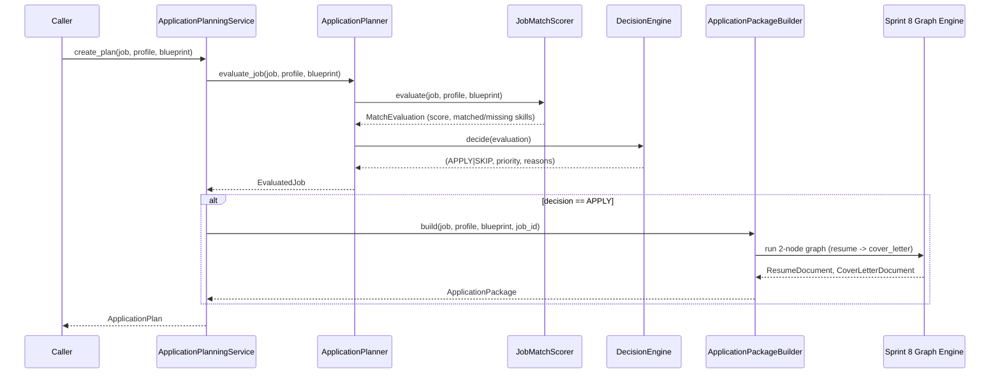

# Application Planning Engine (Sprint 9)

## 1. Purpose

The Application Planning Engine (`app/application_planning/`) is the
decision-making layer between Job Discovery (Sprint 7) and future Browser
Automation. Given a `DiscoveredJob`, it scores how well it matches a
candidate, decides APPLY or SKIP with a priority, and — only for jobs
worth applying to — builds a tailored resume and cover letter, ready to
hand off to an automated application step.

`ApplicationPlanningService` is the single facade — nothing else in this
package is a public entrypoint, mirroring every prior sprint's convention.

## 2. Architecture

```
app/application_planning/
├── models.py            # ApplicationDecision, ApplicationPriority, MatchEvaluation,
│                        # EvaluatedJob, ApplicationPlan, ApplicationPackage
├── exceptions.py          # ApplicationPlanningError hierarchy
├── interfaces.py            # Protocols: JobMatchScorer/DecisionEngine/PackageBuilder
├── scorer.py                  # JobMatchScorer: match_score + skill evaluation
├── decision.py                  # DecisionEngine: APPLY/SKIP + priority
├── planner.py                     # ApplicationPlanner: composes scorer + decision
├── package_builder.py               # ApplicationPackageBuilder: resume + cover letter via Sprint 8
└── service.py                         # ApplicationPlanningService: the public facade
```

### Dependency direction

```
caller  →  ApplicationPlanningService  →  ApplicationPlanner  →  JobMatchScorer  →  JobRankingEngine (Sprint 7)
                    │                              │                                →  SkillMatcher (Sprint 3)
                    │                              └→  DecisionEngine
                    │
                    └→  ApplicationPackageBuilder  →  Graph + GraphExecutor (Sprint 8)
                                                        →  ResumeGeneratorNode (Sprint 8 adapter, wraps Sprint 5)
                                                        →  CoverLetterGeneratorNode (Sprint 8 adapter, wraps Sprint 6)
```

Scoring and generation are deliberately separate classes
(`ApplicationPlanner` vs. `ApplicationPackageBuilder`): a caller can
cheaply `evaluate_job()` hundreds of discovered jobs and only pay the cost
of resume/cover-letter generation (LLM calls, template rendering) for the
handful it decides to APPLY to.

## 3. Flow diagram



## 4. Decision process

`DecisionEngine.decide(evaluation)` is deterministic and threshold-based —
transparent and explainable, consistent with `app.intelligence.skill_matcher`
and `app.job_discovery.ranking` being heuristics rather than black boxes.
Every decision returns human-readable `reasons`.

```
if match_score < apply_score_threshold (default 50.0):
    SKIP, LOW priority — "Match score below threshold"
elif missing_required_skill_count > max_missing_required_skills (default 3):
    SKIP, LOW priority — "Too many required skills missing"
else:
    APPLY
    priority = HIGH   if match_score >= high_priority_threshold (default 80.0)
             = MEDIUM if match_score >= medium_priority_threshold (default 60.0)
             = LOW    otherwise
```

All four cutoffs live in `DecisionThresholds` (a `pydantic.BaseModel`),
injectable into `DecisionEngine(thresholds=...)` for a different applicant
risk tolerance without touching any code.

## 5. Match scoring

`JobMatchScorer.evaluate()` reuses two existing components rather than
reimplementing scoring math:

1. **Overall `match_score`** — Sprint 7's `JobRankingEngine.rank()`, which
   already weighs skills (40%), experience (15%), location (15%), remote
   preference (10%), salary (10%), and company preference (10%) against
   `CareerProfile`/`ResumeBlueprint`, each with its own explanation.
2. **`matched_skills` / `missing_skills`** — Sprint 3's `SkillMatcher.match()`
   directly, called with `job.skills` as the *required* group and
   `blueprint.recommended_skills` (when a blueprint is given) as the
   *preferred* group. This is the same tool `JobRankingEngine` already
   uses internally for its own skill factor, exposed here as a first-class
   `MatchEvaluation` rather than folded into one score.

`MissingSkill` (from `app.intelligence.models`, Sprint 3) is reused
directly — its `importance` field ("required"/"preferred") is exactly the
required-vs-preferred distinction this sprint needs, with no new model
required. `MatchEvaluation.missing_required_skills`/`missing_preferred_skills`
are convenience properties filtering on that field.

## 6. Application package

`ApplicationPackageBuilder.build()` wires **Sprint 8's Graph Orchestration
Engine** — not direct service calls — using the exact adapter nodes Sprint
8 ships:

```python
graph = Graph(f"application_package_{job_id}")
graph.add_node(ResumeGeneratorNode("resume", resume_service, ...))
graph.add_node(CoverLetterGeneratorNode(
    "cover_letter", cover_letter_service, dependencies=["resume"], resume_document_input="resume", ...
))
await GraphExecutor().run(graph, context=context)
```

This is a real, load-bearing use of the graph engine: the two-node
pipeline gets retry/timeout/tracing for free, and a future third
generation step (e.g. a screening-question answerer) is one more node —
no rewrite of `package_builder.py`. A `GraphExecutionError` from the
executor (e.g. a `ResumeValidationError` inside the resume node) is caught
and re-raised as `PackageBuildError(job_id, original)`.

`ApplicationPackage` bundles both generated documents *and* their
pre-rendered Markdown (`ResumeGenerationService.to_markdown()`/
`CoverLetterGenerationService.to_markdown()`, called once here) plus the
job's `application_url` — everything a future browser-automation step
needs, with no further sprint-3–7 calls required.

`ApplicationPlan.generated_resume`/`generated_cover_letter` are populated
from the same package when `create_plan()` decides APPLY and a package
builder is configured; they stay `None` for a SKIP decision or when no
builder was injected (a caller wanting decisions only, with no
generation cost, can construct `ApplicationPlanningService()` with no
package builder at all).

## 7. Usage examples

```python
from app.application_planning.package_builder import ApplicationPackageBuilder
from app.application_planning.service import ApplicationPlanningService

# Decisions only — cheap, no LLM calls, no package builder needed:
service = ApplicationPlanningService()
evaluated = service.evaluate_job(discovered_job, career_profile, resume_blueprint)
print(evaluated.decision, evaluated.priority, evaluated.reasons)

# Full pipeline — score, decide, and (if APPLY) generate documents:
builder = ApplicationPackageBuilder(resume_generation_service, cover_letter_generation_service)
service = ApplicationPlanningService(package_builder=builder)

plan = await service.create_plan(discovered_job, career_profile, resume_blueprint)
if plan.decision.value == "apply":
    print(plan.priority, plan.match_score)
    print(plan.generated_resume.full_name)
    print(plan.generated_cover_letter.company_name)

# Or build a package directly, independent of the decision step:
package = await service.build_application_package(discovered_job, career_profile, resume_blueprint)
print(package.resume_markdown)
print(package.application_url)
```

Custom risk tolerance:

```python
from app.application_planning.decision import DecisionEngine, DecisionThresholds
from app.application_planning.planner import ApplicationPlanner

conservative = ApplicationPlanner(
    decision_engine=DecisionEngine(DecisionThresholds(
        apply_score_threshold=70.0, max_missing_required_skills=1,
    )),
)
service = ApplicationPlanningService(planner=conservative, package_builder=builder)
```

## 8. Structured logging

Every stage logs via `loguru` (the project's established structured
logger, `app/core/logging.py`), bound with contextual fields (`job_id`,
`company`) rather than plain string interpolation: `scorer.py` logs each
job's computed score, `decision.py` logs the final decision + priority +
reasons, and `package_builder.py` logs success/failure per package build.

## 9. Testing strategy

41 tests, 100% line coverage on `app/application_planning/` (target: >95%).
No database dependency, no real LLM/network calls — reuses existing
scripted-LLM fixtures from Sprints 5–7.

- `test_application_planning_models.py` — `MatchEvaluation` property splits, serialization round-trip
- `test_application_planning_scorer.py` — score bounds, matched/missing skills, blueprint-as-preferred, dedup
- `test_application_planning_decision.py` — every threshold boundary (skip, apply, all three priorities), custom thresholds
- `test_application_planning_planner.py` — composition of scorer + decision, custom decision engine injection
- `test_application_planning_package_builder.py` — successful build, `PackageBuildError` on generation failure, custom templates
- `test_application_planning_service.py` — APPLY path (generates documents), SKIP path (doesn't), no-builder-configured behavior, explicit vs. auto-derived `job_id` (via Sprint 7's `content_hash`), `PlanningConfigurationError`
- `test_application_planning_interfaces.py` — structural `Protocol` conformance
