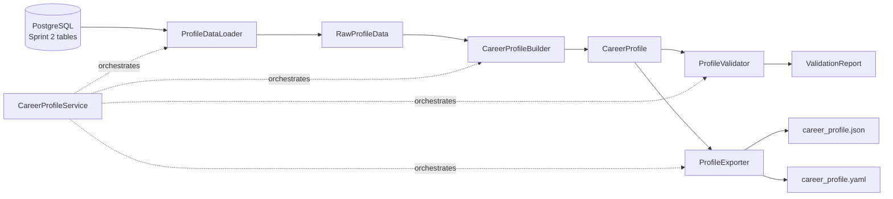

# Master Career Profile Engine

Sprint 3.5's deliverable: a **Career Profile Service** that aggregates
everything known about a user — personal info, education, experience,
projects, skills, certificates, GitHub activity, and derived application/
interview preferences — into one `CareerProfile` object. This is meant to
become the single source of truth every future AI feature reads from
instead of querying the database directly or hardcoding assumptions about
the user: resume generation, cover letter generation, job applications,
interview preparation, AI chat, question answering, and browser
automation all consume the same profile.

This sprint builds **only** the aggregation, validation, and export layer.
No AI APIs, no PDF generation, no resume/cover-letter generation, no
scraping, no browser automation — those are later sprints.

## Architecture

```
app/career_profile/
├── models.py     # Pydantic models: CareerProfile and its sub-sections
├── loader.py      # The only module that touches the database
├── builder.py      # Pure transformation: RawProfileData -> CareerProfile
├── validator.py     # Completeness validation + data quality scoring
├── exporter.py       # JSON / YAML serialization
└── service.py         # CareerProfileService — the entrypoint everything else uses
```

- **`loader.py`** is the only module that imports a repository or an
  `AsyncSession`. It reads `User`, `Education`, `Experience`, `Project`,
  `Skill`, `Certificate`, `GithubRepository`, `Resume`/`ResumeVersion`,
  `Application`, `Job`, and `Interview` rows (via the existing Sprint 2
  repositories — no new repository methods were added) and bundles them
  into a `RawProfileData` dataclass: plain SQLAlchemy ORM instances, not
  yet serializable.
- **`builder.py`** takes a `RawProfileData` and produces a `CareerProfile`
  — a pure, side-effect-free transformation. Because it never touches the
  database, it's unit-testable with hand-built in-memory ORM instances
  (see `tests/test_career_profile_builder.py`).
- **`validator.py`** and **`exporter.py`** both operate on a `CareerProfile`
  only — no database, no ORM types — so they're independently testable
  the same way.
- **`service.py`** is the only class other code should import: it wires
  the loader, builder, validator, and exporter together behind four
  methods (`build_profile`, `validate_profile`, `export_json`,
  `export_yaml`), all keyed by `user_id`.

This mirrors the Clean Architecture split already established in Sprint 2
(repositories) and Sprint 3 (the intelligence engine's `career_context.py`
pattern): one DB-facing module, everything else pure and swappable.

## Data flow



1. `CareerProfileService.build_profile(user_id)` calls
   `ProfileDataLoader.load(user_id)`, which fetches every row belonging to
   that user across 9 tables (raising `ValueError` if the user doesn't
   exist).
2. `CareerProfileBuilder.build(raw)` maps each ORM row onto its matching
   Pydantic `*Profile` model — a faithful, field-for-field mirror, with no
   fabricated or default-guessed content. `PreferenceProfile` is the one
   section that's *derived* rather than mirrored 1:1 (see below).
3. `validate_profile(user_id)` builds the profile, then runs
   `ProfileValidator.validate()` over it.
4. `export_json(user_id)` / `export_yaml(user_id)` build the profile, then
   write it via `ProfileExporter` to `data/career_profiles/{user_id}.json`
   / `.yaml` by default (overridable per call).

### Preferences: derived, not hardcoded

Sprint 2's schema has no dedicated "user preferences" table, so
`ApplicationPreference` and `InterviewPreference` are computed from
*actual history* rather than fabricated:

| Field | Derived from |
|---|---|
| `preferred_employment_types` / `preferred_remote_types` | Frequency count (`collections.Counter`) over the `Job` rows behind the user's `Application`s, most common first |
| `preferred_locations` | Same frequency approach, over `Job.location` |
| `observed_salary_min` / `observed_salary_max` | Min/max of `Job.salary_min` / `Job.salary_max` across applied jobs |
| `total_resume_versions` | Count of `ResumeVersion` rows across all the user's `Resume`s |
| `preferred_interview_types` | Frequency count over `Interview.interview_type` |
| `average_duration_minutes` | Mean of `Interview.duration_minutes` where set |

Every one of these is `0`/empty/`None` when there's no history to derive
it from — nothing here is ever a guessed or placeholder value.

## How AI will consume the profile

Every future AI feature is meant to depend on `CareerProfileService`
rather than the database:

- **Resume generation** reads `education`, `experience`, `projects`,
  `skills`, `certificates` — the same shape Sprint 3's
  `app.intelligence.career_context.CareerContext` already consumes from
  the same underlying tables, just aggregated once here instead of
  per-feature.
- **Cover letter generation** reads `personal_info` + `preferences.application`
  to tailor tone/target company language.
- **Job application automation** reads `preferences.application` to decide
  which postings match the user's historical employment-type/remote/
  salary pattern.
- **Interview preparation** reads `preferences.interview` to weight prep
  material toward the interview types the user actually encounters most.
- **AI chat / question answering** reads the full `CareerProfile` as
  grounding context — the JSON/YAML export exists specifically so it can
  be dropped into a prompt or a retrieval index without a database
  round-trip.
- **Browser automation** (a later sprint) reads `personal_info` to fill
  application forms — again, no direct database access.

`export_json`/`export_yaml` exist because an LLM-facing pipeline often
wants a static document (for a prompt, a cache, a retrieval index) rather
than a live object — both are the same data, just serialized.

## JSON example

Real output of `CareerProfileService.build_profile(user_id)` for a user
with one education entry, one current experience, one featured project,
one skill, one GitHub repo, and one job application (no phone/portfolio/
certificates — intentionally sparse, to also show what an incomplete
profile looks like):

```json
{
  "user_id": "e02bf17a-a775-4441-8f34-da577171fc9a",
  "generated_at": "2026-07-28T06:27:27.851573Z",
  "personal_info": {
    "full_name": "Sam Rivera",
    "email": "sample@example.com",
    "phone": "555-0100",
    "location": "Remote",
    "headline": "Backend Engineer",
    "summary": null,
    "linkedin_url": "https://linkedin.com/in/samrivera",
    "portfolio_url": null,
    "timezone": null
  },
  "education": [
    {
      "institution": "MIT",
      "degree": "BSc Computer Science",
      "field_of_study": "Computer Science",
      "start_date": "2018-09-01",
      "end_date": "2022-06-01",
      "is_current": false,
      "gpa": 3.8,
      "description": null
    }
  ],
  "experience": [
    {
      "title": "Backend Engineer",
      "company_name": "Acme Corp",
      "location": null,
      "start_date": "2022-07-01",
      "end_date": null,
      "is_current": true,
      "description": "Building APIs.",
      "achievements": ["Reduced latency by 40%"],
      "technologies": ["Python", "FastAPI"]
    }
  ],
  "projects": [
    {
      "name": "Market Data Platform",
      "description": "Real-time market data platform using FastAPI and PostgreSQL.",
      "technologies": ["FastAPI", "PostgreSQL", "Docker"],
      "achievements": [],
      "github_url": null,
      "demo_url": null,
      "priority": "featured",
      "start_date": null,
      "end_date": null
    }
  ],
  "skills": [
    {"name": "Python", "category": "other", "years_experience": 5.0, "confidence_level": 5}
  ],
  "certificates": [],
  "github_repositories": [
    {
      "name": "hello-world",
      "full_name": "samrivera/hello-world",
      "description": null,
      "url": "https://github.com/samrivera/hello-world",
      "stars": 12,
      "forks": 2,
      "primary_language": "Python",
      "topics": [],
      "is_featured": false,
      "last_synced_at": null
    }
  ],
  "preferences": {
    "application": {
      "total_applications": 1,
      "total_resume_versions": 0,
      "preferred_employment_types": ["full_time"],
      "preferred_remote_types": ["remote"],
      "preferred_locations": ["Remote"],
      "observed_salary_min": 120000.0,
      "observed_salary_max": 150000.0
    },
    "interview": {
      "total_interviews": 0,
      "preferred_interview_types": [],
      "average_duration_minutes": null
    }
  }
}
```

## YAML example

The same profile via `export_yaml` (`yaml.safe_dump(..., sort_keys=False)`
— key order matches the Pydantic model, not alphabetical):

```yaml
user_id: e02bf17a-a775-4441-8f34-da577171fc9a
generated_at: '2026-07-28T06:27:27.851573Z'
personal_info:
  full_name: Sam Rivera
  email: sample@example.com
  phone: 555-0100
  location: Remote
  headline: Backend Engineer
  summary: null
  linkedin_url: https://linkedin.com/in/samrivera
  portfolio_url: null
  timezone: null
education:
- institution: MIT
  degree: BSc Computer Science
  field_of_study: Computer Science
  start_date: '2018-09-01'
  end_date: '2022-06-01'
  is_current: false
  gpa: 3.8
  description: null
# ... (experience, projects, skills, certificates, github_repositories — same shape as the JSON above)
preferences:
  application:
    total_applications: 1
    total_resume_versions: 0
    preferred_employment_types:
    - full_time
    preferred_remote_types:
    - remote
    preferred_locations:
    - Remote
    observed_salary_min: 120000.0
    observed_salary_max: 150000.0
  interview:
    total_interviews: 0
    preferred_interview_types: []
    average_duration_minutes: null
```

## Validation system

`ProfileValidator.validate(profile)` returns a `ValidationReport`:

```python
class ValidationReport(BaseModel):
    is_valid: bool
    issues: list[ValidationIssue]       # field, message, severity
    completeness: CompletenessReport    # per-section + overall score
```

### Issues checked

| Check | Field | Severity |
|---|---|---|
| Missing email | `personal_info.email` | `error` (invalidates the profile) |
| Missing phone | `personal_info.phone` | `warning` |
| Missing LinkedIn | `personal_info.linkedin_url` | `warning` |
| Missing GitHub | `github_repositories` (empty) | `warning` |
| Missing projects | `projects` (empty) | `warning` |
| Missing skills | `skills` (empty) | `warning` |
| Missing education | `education` (empty) | `warning` |

`is_valid` is `False` only when a truly structural field is empty (email —
the one field every downstream feature assumes exists); every other gap is
a `warning`, since a profile can be perfectly usable with, say, no
certificates.

### Completeness / data quality score

Every section gets a 0–100 score:

- **Personal Information**: `filled_fields / 9 * 100`, where the 9 fields
  are `full_name, email, phone, location, headline, summary, linkedin_url,
  portfolio_url, timezone`.
- **Every list section** (Education, Experience, Projects, Skills,
  Certificates, GitHub): `0` if the list is empty; otherwise the *average*
  per-item fill ratio over a curated "richness" field list — having an
  entry at all isn't enough to score 100%, the entry also needs its
  optional detail fields filled in.

| Section | Fields checked |
|---|---|
| Education | `field_of_study, start_date, end_date, gpa, description` |
| Experience | `location, description, achievements, technologies` |
| Projects | `description, technologies, achievements, github_url, demo_url` |
| Skills | `years_experience, confidence_level` |
| Certificates | `issue_date, expiration_date, credential_id, credential_url` |
| GitHub | `description, primary_language, topics` |

A field counts as "filled" if it's not `None`, not an empty/whitespace
string, and not an empty list.

**Overall score** is a weighted average:

```
overall = Personal Information * 0.20
        + Education             * 0.15
        + Experience            * 0.15
        + Projects              * 0.20
        + Skills                * 0.15
        + Certificates          * 0.05
        + GitHub                * 0.10
```

Personal Information and Projects are weighted highest (0.20 each) since
they're what every downstream AI feature reads first; Certificates count
least (0.05) since most roles don't require any, so a missing/sparse
Certificates section shouldn't drag the overall score down much.

Example — the completeness report for the sample profile above:

```json
{
  "sections": [
    {"name": "Personal Information", "score": 66.7, "item_count": 1},
    {"name": "Education", "score": 80.0, "item_count": 1},
    {"name": "Experience", "score": 75.0, "item_count": 1},
    {"name": "Projects", "score": 40.0, "item_count": 1},
    {"name": "Skills", "score": 100.0, "item_count": 1},
    {"name": "Certificates", "score": 0.0, "item_count": 0},
    {"name": "GitHub", "score": 33.3, "item_count": 1}
  ],
  "overall_score": 62.9
}
```

(Personal Information scores 66.7% here because 6 of 9 fields are filled —
`summary`, `portfolio_url`, and `timezone` are empty on this particular
sample user; Skills scores 100% because the one skill entry has both
`years_experience` and `confidence_level` set.)

## Testing

- **Unit** (`tests/test_career_profile_builder.py`,
  `test_career_profile_validator.py`, `test_career_profile_exporter.py`)
  — pure Pydantic/dataclass data, no database. Builder tests construct
  in-memory ORM instances directly (never added to a session) to verify
  the transformation logic in isolation; validator tests cover the
  missing-field checks and the completeness formula precisely; exporter
  tests round-trip JSON/YAML output and verify file writes.
- **Integration** (`tests/test_career_profile_service.py`) — uses the
  `db_session` fixture (real PostgreSQL) to exercise
  `CareerProfileService` end to end: seed a user with real rows, then
  `build_profile`, `validate_profile`, `export_json`, `export_yaml`, and
  check the written files.

## Rules followed

No AI APIs (Claude, OpenAI, or otherwise), no browser automation, no job
scraping, no resume/cover-letter/PDF generation — this sprint is
aggregation, validation, and export only. `EmploymentType`, `RemoteType`,
`InterviewType`, `SkillCategory`, and `ProjectPriority` are reused directly
from `app.models.enums` (a read-only import); Sprint 1–3 code is
unmodified except for the addition of the `pyyaml` dependency required for
YAML export.
