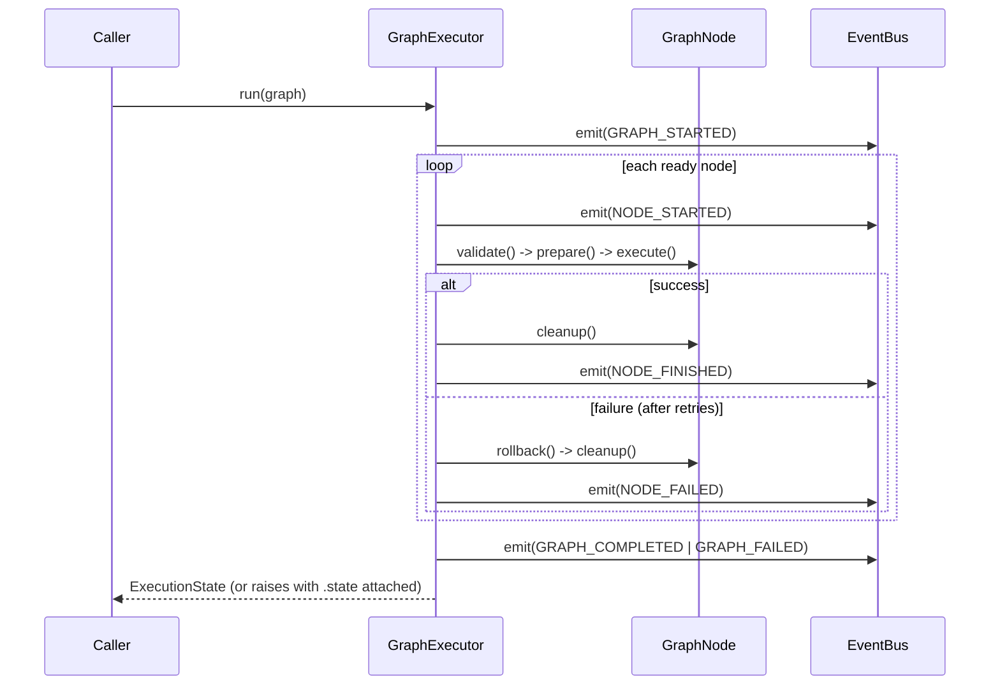
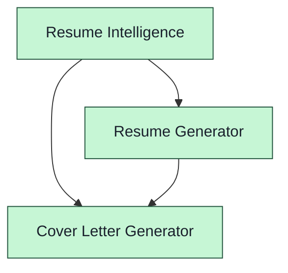

# Graph Orchestration Engine (Sprint 8)

## 1. Purpose

The Graph Orchestration Engine (`app/graph/`) is the execution backbone for
every AI capability AutoHireAI ships. It replaces the implicit "pipeline"
shape of Sprints 3–7 (each service calling the next directly) with an
explicit **directed acyclic graph (DAG)** of `GraphNode`s, executed by a
home-grown async engine: dependency resolution, topological ordering,
parallel execution, retries, timeouts, cancellation, checkpointing, an
event system, a plugin registry, a scheduler architecture, and
visualization — all with **zero external workflow-engine dependency**
(stdlib + Pydantic only). No LangGraph, no Celery, no Airflow.

Every Sprint 3–7 service becomes a graph node through a thin **adapter**
(`app/graph/adapters/`) that only calls that service's existing public
methods — none of Sprint 3, 3.5, 5, 6, or 7's business logic changed.

## 2. Architecture

```
app/graph/
├── exceptions.py      # GraphError hierarchy
├── state.py             # ExecutionStatus, NodeExecutionRecord, ExecutionState (serializable)
├── events.py             # EventType, Event, EventBus (pub/sub)
├── retry.py               # RetryPolicy hierarchy
├── memory.py                # GraphMemory (node outputs, shared scratch space, history)
├── context.py                 # ExecutionContext (memory + inputs + cancellation token)
├── metrics.py                   # MetricsCollector, NodeMetrics/GraphMetrics
├── interfaces.py                  # Protocols: GraphNodeProtocol, CheckpointStoreProtocol, ...
├── node.py                          # GraphNode (abstract base: the node contract)
├── edge.py                            # GraphEdge
├── graph.py                            # Graph (the DAG itself)
├── registry.py                           # NodeRegistry (plugin system)
├── planner.py                              # ExecutionPlanner (static wave computation)
├── scheduler.py                              # GraphScheduler (dynamic priority queue)
├── checkpoint.py                               # CheckpointStore (persist/resume)
├── executor.py                                   # GraphExecutor (runs a Graph)
├── visualizer.py                                   # GraphVisualizer (Mermaid/ASCII/tree)
├── service.py                                        # GraphService (the public facade)
├── __init__.py
└── adapters/
    ├── _common.py           # resolve_input() shared helper
    ├── career_profile.py     # CareerProfileNode          (wraps Sprint 3.5)
    ├── resume_intelligence.py # ResumeIntelligenceNode    (wraps Sprint 3)
    ├── resume_generator.py     # ResumeGeneratorNode      (wraps Sprint 5)
    ├── cover_letter_generator.py # CoverLetterGeneratorNode (wraps Sprint 6)
    └── job_discovery.py           # JobDiscoveryNode      (wraps Sprint 7)
```

### Dependency direction (bottom-up; no cycles)

```
exceptions.py
    ↓
state.py    events.py    retry.py    memory.py
    ↓            ↓           ↓           ↓
    └──────────────┬─────────┴───────────┘
                 context.py    metrics.py
                     ↓
                interfaces.py    node.py    edge.py
                     ↓              ↓          ↓
                     └──────────────┼──────────┘
                                 graph.py
                                    ↓
              registry.py    planner.py    scheduler.py    checkpoint.py
                     ↓              ↓            ↓               ↓
                     └──────────────┴────────────┴───────────────┘
                                 executor.py
                                    ↓
                              visualizer.py    service.py
                                    ↓
                              adapters/*.py  (also depends on the wrapped Sprint 3-7 service)
```

A node *definition* (`GraphNode`) is a **stateless, reusable template** —
the same design Airflow draws between an Operator and a TaskInstance, and
Prefect between a Task and a TaskRun. Per-run status, timing, retry count,
and error live in `ExecutionState`/`NodeExecutionRecord` (`state.py`), not
mutated directly on the node instance, so the same `Graph` can be executed
— even concurrently, from multiple calls — without one run's bookkeeping
clobbering another's. Each node also gets a convenience `last_record`
attribute the executor updates after each attempt, for simple
single-run introspection.

## 3. Execution model

`GraphExecutor.run(graph, ...)` supports two modes:

- **`ExecutionMode.SEQUENTIAL`** — nodes run one at a time, in topological order.
- **`ExecutionMode.PARALLEL`** (default) — nodes run the instant their
  dependencies finish, via `GraphScheduler`'s pull-based priority queue,
  optionally bounded by `max_concurrency`.

**DAG failure semantics** (identical in both modes): a failed node skips
only its *downstream dependents* — independent branches keep running. A
node with `optional=True` never fails the overall graph run (its own
failure is still recorded); every other node's failure raises
`GraphExecutionError` once the run finishes attempting everything it could.

**Cancellation** is cooperative: build an `ExecutionContext` yourself,
pass it into `run(graph, context=context)`, hold onto it, and call
`context.cancel()` from another task while `run()` is awaited elsewhere.
Execution stops between node launches; already-running parallel tasks are
cancelled via `asyncio.Task.cancel()`.

**Timeouts** are per-node (`GraphNode(..., timeout_seconds=30)`), enforced
with `asyncio.wait_for` around `execute()`.

**Tracing**: every `Event` emitted is appended to
`ExecutionState.trace` — a full, inspectable/serializable timeline of the run.



## 4. Node lifecycle

Every `GraphNode` subclass implements one required method and may override four optional hooks:

| Method | Required | Called when | Failure behavior |
|---|---|---|---|
| `validate(context)` | optional (default no-op) | before `prepare()` | raises → node fails immediately, no retry |
| `prepare(context)` | optional (default no-op) | after `validate()`, before the retry loop | raises → node fails immediately, no retry |
| `execute(context)` | **required** | the node's actual work | raises → retried per `retry_policy`, then fails |
| `cleanup(context)` | optional (default no-op) | always, after success or final failure | exceptions swallowed (best-effort) |
| `rollback(context)` | optional (default no-op) | only after `execute()` ultimately failed | exceptions swallowed (best-effort) |

`validate()`/`prepare()` are **not** retried — they represent programming
errors or missing preconditions, not transient failures. Only `execute()`
is retried, per the node's `retry_policy`.

## 5. Retry policies (`retry.py`)

| Policy | Behavior |
|---|---|
| `NoRetryPolicy` | Never retries — the first failure is final (the `GraphNode` default). |
| `ImmediateRetryPolicy(max_retries)` | Retries immediately, no delay. |
| `FixedDelayRetryPolicy(delay_seconds, max_retries)` | Waits a constant delay before every retry. |
| `ExponentialBackoffRetryPolicy(base_delay, factor, max_delay, max_retries)` | `base_delay * factor^(attempt-1)`, capped at `max_delay`. |

Every policy also takes `retryable_exceptions: tuple[type[Exception], ...]`
(default `(Exception,)`) — only matching exception types are retried;
anything else fails immediately regardless of remaining retry budget.
`max_retries=2` means up to 3 total attempts (the initial try + 2 retries).

```python
from app.graph.retry import ExponentialBackoffRetryPolicy

node = MyApiCallNode(
    "call_api", retry_policy=ExponentialBackoffRetryPolicy(
        base_delay=1.0, factor=2.0, max_delay=30.0, max_retries=4,
        retryable_exceptions=(ConnectionError, TimeoutError),
    ),
)
```

## 6. Scheduler (`scheduler.py`)

`GraphScheduler` is a dependency-aware, priority-ordered **pull-based**
queue — distinct from `planner.py`'s static wave computation. A node
becomes ready the instant its dependencies finish (`mark_complete()`), not
only at a wave boundary, and `pop_ready()`/`pop_all_ready()` return the
highest-priority ready node(s) (ties broken by node id).

This is deliberately the seam a **future distributed backend** would
replace: `pop_ready()` becomes "dequeue from a shared broker" (Celery,
Ray, a Redis-backed queue) and `mark_complete()` becomes "publish
completion back to the broker" — the dependency/priority bookkeeping here
doesn't change, only the transport underneath it. **No external scheduler
is used or required today**; `executor.py`'s in-process `PARALLEL` mode is
the only consumer this sprint.

## 7. Memory (`memory.py` / `context.py`)

`GraphMemory` holds:

- `outputs: dict[node_id, Any]` — every completed node's return value
- `shared: dict[str, Any]` — a free-form scratch space any node can read/write
- `history: list[str]` — an append-only log of `"{node_id} -> output set"` entries

`ExecutionContext` wraps `GraphMemory` with per-run identity
(`graph_id`, `run_id`), caller-supplied `inputs`, and the cancellation
token. Every node's `execute(context)` reads via `context.get_input(name)`
/ `context.get_output(node_id)` and its return value is automatically
stored as `context.get_output(self.id)` by the executor — a node never
calls `set_output` itself.

## 8. Checkpointing (`checkpoint.py`)

Only `ExecutionState` — status, timing, retry count, error, and the event
trace, all fully JSON-serializable Pydantic — is persisted, **not**
`GraphMemory`'s node outputs, which may be arbitrary non-serializable
Python objects (a `CareerProfile`, a `ResumeDocument`, ...). Resuming
therefore re-runs any node whose output isn't still available in the
in-process `GraphMemory` passed to `resume()`.

```python
from app.graph.checkpoint import FileCheckpointStore
from app.graph.executor import GraphExecutor
from app.graph.exceptions import GraphExecutionError

store = FileCheckpointStore("data/graph_checkpoints")
executor = GraphExecutor(checkpoint_store=store)

try:
    state = await executor.run(graph, checkpoint=True)
except GraphExecutionError as exc:
    # exc.state is already checkpointed; fix the underlying issue, then:
    resumed = await executor.resume(graph, exc.state, checkpoint=True)
```

`InMemoryCheckpointStore` is the process-local equivalent, useful for
tests and short-lived runs. Checkpoint ids are `"{graph_id}:{run_id}"`;
`FileCheckpointStore` maps that to `{directory}/{graph_id}/{run_id}.json`
(not a literal colon in the filename — invalid on Windows).

## 9. Event system (`events.py`)

`EventType`: `GRAPH_STARTED`, `GRAPH_COMPLETED`, `GRAPH_FAILED`,
`GRAPH_CANCELLED`, `NODE_STARTED`, `NODE_FINISHED`, `NODE_FAILED`,
`NODE_RETRYING`, `NODE_SKIPPED`, `NODE_CANCELLED`.

`EventBus.subscribe(callback, event_type=None)` — subscribe to one type or
every event; callbacks may be sync or async (`emit()` awaits either).
This is the "Observers/Callbacks" extension point: attach logging,
metrics export, or UI-streaming without `executor.py` knowing anything
about the subscriber.

## 10. Plugin registry (`registry.py`)

Mirrors Sprint 4/7's self-registration convention
(`app.llm.registry`/`app.job_discovery.providers.base`), generalized to
factories rather than bare classes — since some nodes (the adapters) need
more than `GraphNode`'s base fields to construct (a wrapped service
instance). Implemented with idiomatic Python `snake_case` method names
(`register_node`/`remove_node`/`lookup_node`/`discover_nodes`) rather than
literal `PascalCase`, to stay consistent with every other sprint's style
and this project's `ruff`/PEP 8 conventions — the capability described
(register/remove/lookup/discover) is exactly what's implemented.

```python
from app.graph.registry import NodeRegistry

registry = NodeRegistry()
registry.register_node("resume_intelligence", ResumeIntelligenceNode)  # a plain class
registry.register_node("career_profile", lambda d: CareerProfileNode(d["id"], my_service))  # a factory

@registry.register("my_custom_node")     # decorator form
class MyCustomNode(GraphNode): ...

registry.discover_nodes()   # -> sorted list of every registered name
registry.remove_node("my_custom_node")
```

`Graph.serialize()`/`Graph.deserialize(data, registry)` use this registry
to reconstruct node *structure* (id, name, dependencies, metadata, ...) —
node *behavior* beyond base fields (an adapter's wrapped service) isn't
generically serializable, matching how Airflow/Prefect handle
deserializing DAGs with operator-specific, non-serialized dependencies.

## 11. Visualization (`visualizer.py`)

Four pure, dependency-free renderers over a `Graph` (optionally annotated
with an `ExecutionState`):

- **`to_mermaid(state=None)`** — a Mermaid `flowchart TD`, colored by status when `state` is given
- **`to_ascii()`** — a deterministic topological listing with dependencies inline
- **`execution_tree(state)`** — nested indentation by dependency depth, annotated with status + duration
- **`dependency_graph()`** — `{node_id: [dependency ids]}`, for programmatic consumption



## 12. Metrics (`metrics.py`)

`MetricsCollector` (a context manager) measures, per node execution:
wall-clock time (`time.perf_counter`), CPU time (`time.process_time`), and
memory delta (`tracemalloc` — cross-platform, unlike POSIX-only
`resource.getrusage`; this measures Python-object allocation deltas, not
full process RSS, which is the right trade-off for a lightweight,
dependency-free engine). `compute_graph_metrics(state)` aggregates a
completed `ExecutionState` into a `GraphMetrics` summary (counts by
status, per-node metrics, total execution time).

## 13. Integrating existing modules: adapters (`adapters/`)

Every adapter wraps an already-constructed Sprint 3–7 service instance
(these services need live dependencies — an `AsyncSession`, an
`LLMService` — the graph engine has no opinion about how those are
built) and only calls that service's existing public method:

| Adapter | Wraps | Calls |
|---|---|---|
| `CareerProfileNode` | `CareerProfileService` (3.5) | `build_profile(user_id)` |
| `ResumeIntelligenceNode` | `ResumePlanner` (3) | `plan(job, career_context)` |
| `ResumeGeneratorNode` | `ResumeGenerationService` (5) | `generate_document(...)` |
| `CoverLetterGeneratorNode` | `CoverLetterGenerationService` (6) | `generate_document(...)` |
| `JobDiscoveryNode` | `JobDiscoveryService` (7) | `discover_ranked(...)` |

Each resolves its arguments via `resolve_input(context, name)`
(`adapters/_common.py`): prefer an explicit graph input, fall back to an
upstream node's output when the input name matches a dependency's node
id. **Known gap, by design, not an oversight**: `ResumeIntelligenceNode`
requires Sprint 3's own `CareerContext`, not Sprint 3.5's `CareerProfile`
— no adapter between those two shapes exists upstream yet (see
Sprint 5's own research notes), and inventing one silently inside this
graph adapter would be "modifying," not "wrapping," business logic. A
future sprint adding that conversion is a natural next adapter, not a
change to this one.

## 14. Usage example

```python
from app.graph.adapters.resume_intelligence import ResumeIntelligenceNode
from app.graph.adapters.resume_generator import ResumeGeneratorNode
from app.graph.adapters.cover_letter_generator import CoverLetterGeneratorNode
from app.graph.context import ExecutionContext
from app.graph.graph import Graph
from app.graph.service import GraphService

graph = Graph("job_application_pipeline")
graph.add_node(ResumeIntelligenceNode("blueprint", resume_planner))
graph.add_node(ResumeGeneratorNode("resume", resume_service, dependencies=["blueprint"]))
graph.add_node(CoverLetterGeneratorNode(
    "cover_letter", cover_letter_service,
    dependencies=["blueprint", "resume"], resume_document_input="resume",
))

service = GraphService()
print(service.validate_graph(graph))          # GraphValidationResult(is_valid=True, ...)
print(service.plan_graph(graph))                # [["blueprint"], ["resume"], ["cover_letter"]]
print(service.visualize_graph(graph))            # Mermaid flowchart

context = ExecutionContext(graph_id=graph.id, run_id="run-1", inputs={
    "job": job_posting, "career_context": career_context, "profile": career_profile,
    "company_name": "Acme Corp", "job_title": "Backend Engineer",
})
state = await service.run_graph(graph, context=context)
resume_document = context.get_output("resume")
cover_letter_document = context.get_output("cover_letter")
```

## 15. Future multi-agent support

The engine's design already anticipates multi-agent workflows without
requiring a rewrite:

- **A node can itself be an LLM agent call** — nothing about `GraphNode`
  assumes deterministic logic; an `execute()` that calls `LLMService`
  (Sprint 4) with tool use, or that runs a ReAct-style loop internally, is
  just another node.
- **Conditional/dynamic branching**: today, a failed node skips its
  dependents; a future node type could inspect its own output and
  dynamically decide *which* dependent(s) to allow (an "agent router"
  node), without changing `executor.py` — skip-propagation is already
  driven by node status, not a hardcoded shape.
- **Sub-graphs as nodes**: because `GraphExecutor.run()` takes any `Graph`
  and returns a plain `ExecutionState`, a node's `execute()` can itself
  construct and run a nested `Graph` (e.g., a multi-step agent
  reasoning loop) and return its result — composition requires no new
  primitive.
- **Distributed execution**: `GraphScheduler`'s `pop_ready()`/`mark_complete()`
  seam (§6) is exactly where a message-queue-backed executor would plug
  in for running agents across multiple processes/machines.

## 16. Testing strategy

197 tests, 100% line coverage on `app/graph/` (target: 150+ tests, >95%
coverage). No database dependency, no real LLM/network calls — adapter
tests reuse existing scripted-LLM fixtures from Sprints 5–7
(`tests/resume_fixtures.py`, `tests/cover_letter_fixtures.py`,
`tests/job_discovery_fixtures.py`, `tests/intelligence_fixtures.py`).

- `test_graph_state.py`, `test_graph_events.py`, `test_graph_retry.py`,
  `test_graph_memory.py`, `test_graph_context.py`, `test_graph_metrics.py`,
  `test_graph_node.py`, `test_graph_edge.py` — foundational data models
- `test_graph_core.py` — cycle detection, topological order, validation, serialization round-trip
- `test_graph_registry.py`, `test_graph_planner.py`, `test_graph_scheduler.py` — plugin system, wave planning, priority queue
- `test_graph_checkpoint.py` — in-memory and file-backed save/load/list/delete
- `test_graph_executor.py` — sequential & parallel execution, DAG-aware failure/skip propagation, optional nodes, retries, timeouts, cooperative cancellation (both modes, including a still-running task), lifecycle hook ordering, events, checkpointing, resume (both modes), `max_concurrency`, priority ordering
- `test_graph_visualizer.py`, `test_graph_service.py` — rendering and the facade
- `test_graph_adapters.py`, `test_graph_integration.py` — every adapter individually, plus a full 3-node pipeline run end-to-end in both execution modes
- `test_graph_interfaces.py` — structural `Protocol` conformance
