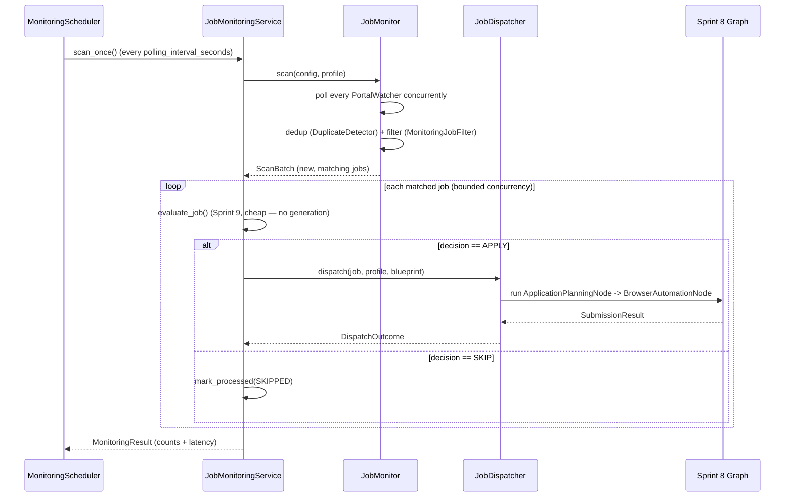

# Real-Time Job Monitoring Engine (Sprint 11)

## 1. Purpose

The Job Monitoring Engine (`app/job_monitoring/`) is the capstone that
closes the loop: it continuously polls Job Discovery (Sprint 7), decides
what's new and relevant, and automatically triggers the full pipeline —
Application Planning (Sprint 9) through Browser Automation (Sprint 10),
wired via Sprint 8's Graph Engine — with no manual intervention required.

`JobMonitoringService` is the single facade — nothing else in this
package is a public entrypoint, mirroring every prior sprint's convention.

## 2. Architecture

```
app/job_monitoring/
├── models.py             # MonitoringJob, MonitoringConfig, MonitoringResult,
│                        # MonitoringStatistics, JobEvent, ProcessedJob, ...
├── exceptions.py           # JobMonitoringError hierarchy
├── interfaces.py             # JobFilterProtocol, DuplicateDetectorProtocol, DispatcherProtocol
├── cache.py                    # JobCache: bounded in-memory LRU-ish key cache
├── history.py                    # MonitoringHistoryStore: durable JSON-Lines ledger
├── deduplication.py                # DuplicateDetector: cross-scan duplicate detection
├── filters.py                        # MonitoringJobFilter: skills/location/company/keywords/custom rules
├── watcher.py                          # PortalWatcher: polls one Sprint 7 provider
├── monitor.py                            # JobMonitor: one scan across every configured portal
├── scheduler.py                            # MonitoringScheduler: the real asyncio interval loop
├── dispatcher.py                             # JobDispatcher: triggers the pipeline for one job
└── service.py                                  # JobMonitoringService: the public facade

app/graph/adapters/            # Sprint 11 additions (purely additive):
├── application_planning.py      # ApplicationPlanningNode  (wraps Sprint 9)
└── browser_automation.py          # BrowserAutomationNode  (wraps Sprint 10)
```

### Dependency direction

```
caller  →  JobMonitoringService  →  MonitoringScheduler (interval loop)
                    │              →  JobMonitor  →  PortalWatcher × N  →  BaseJobProvider (Sprint 7)
                    │                            →  DuplicateDetector  →  JobCache + MonitoringHistoryStore
                    │                            →  MonitoringJobFilter  →  JobFilter (Sprint 7, reused)
                    │
                    └→  JobDispatcher  →  Graph (Sprint 8) = ApplicationPlanningNode -> BrowserAutomationNode
                                        →  ApplicationPlanningService (Sprint 9)
                                        →  BrowserAutomationService (Sprint 10)
```

No module here duplicates a prior sprint's logic — `JobMonitor` polls via
Sprint 7's own `BaseJobProvider.fetch_jobs()`, `MonitoringJobFilter` calls
Sprint 7's `JobFilter` for every criterion it already covers,
`DuplicateDetector` reuses Sprint 7's `content_hash()` directly, and
`JobDispatcher` reuses Sprint 9/10's services through two *new*, purely
additive Sprint 8 graph adapters.

## 3. Monitoring workflow



## 4. Scheduler

Sprints 7 and 8 each shipped a `scheduler.py` that deliberately stopped at
"architecture only — no cron/interval implementation yet." `MonitoringScheduler`
is where that gets resolved for real: a plain `asyncio` interval loop, no
external scheduler/cron dependency.

| Mode | How |
|---|---|
| **Manual polling** | Call `service.scan_once()` directly — the scheduler is never involved. |
| **Scheduled polling** | `service.start_monitoring(...)` runs `scan_once()` every `config.polling_interval_seconds`, then `service.stop_monitoring()` when done. |
| **Continuous monitoring** | The same `start_monitoring()` call — simply never call `stop_monitoring()`. |

`stop()` returns promptly (doesn't block for the remaining interval) by
racing an `asyncio.Event` against the sleep via `asyncio.wait_for`. A
scan that raises never kills the loop — the exception is logged and the
loop continues on the next interval.

## 5. Filtering pipeline

`MonitoringJobFilter.matches(job, criteria, profile)` composes, in order
(all must pass):

1. **Sprint 7's `JobFilter`** against `criteria.base` (a `JobFilterCriteria`)
   — covers remote/hybrid/onsite, experience level, salary, country/city,
   technologies ("skills"), and keywords, unchanged from Sprint 7.
2. **Company blacklist/whitelist** — new in this sprint; a job is dropped
   if its company is blacklisted, or if a whitelist is set and the
   company isn't on it.
3. **Minimum skill overlap** — new in this sprint; if
   `criteria.min_skill_overlap > 0` and a `CareerProfile` is supplied, the
   job is dropped unless at least that many of its listed skills also
   appear in the candidate's own skill list.
4. **Custom rules** — arbitrary `Callable[[DiscoveredJob], bool]`
   predicates passed to `MonitoringJobFilter(custom_rules=[...])` at
   construction (not part of `MonitoringFilterCriteria`, since callables
   aren't Pydantic-serializable) — every rule must return `True`.

## 6. Duplicate detection

`DuplicateDetector.is_duplicate(job)` checks three independent signals —
any one match means "already processed":

1. **Source URL** (normalized, case-insensitive).
2. **Content hash** — Sprint 7's `content_hash()` (`app.job_discovery.deduplication`),
   the same normalized `(title, company, location)` hash Sprint 7 uses to
   dedup within one fetch, reused here to recognize the same posting
   across scans, days apart.
3. **Company + title** (normalized) — catches a re-post at a new URL with
   a slightly different content hash (e.g. an updated description).

`JobCache` (a bounded, stdlib-only LRU-ish set) gives O(1) content-hash
lookups without re-reading the full on-disk history on every check;
`MonitoringHistoryStore` is the durable, append-only ledger
(`data/job_monitoring/history.jsonl`) that survives process restarts —
on first use, the detector's in-memory indexes are warmed from the full
history once, then every subsequent check is O(1).

## 7. Dispatcher

```
Job → Application Planning → Resume Generation → Cover Letter Generation → Browser Automation
```

Resume/cover-letter generation already happens *inside* Sprint 9's
`ApplicationPlanningService.build_application_package()` (itself built on
Sprint 8's graph engine). `JobDispatcher` only has two stages of its own
to wire, so it builds a **two-node Sprint 8 `Graph`**:

```python
graph.add_node(ApplicationPlanningNode("application_planning", planning_service))
graph.add_node(BrowserAutomationNode(
    "browser_automation", browser_service, portal, dependencies=["application_planning"],
))
```

The APPLY/SKIP decision is made **before** `JobDispatcher.dispatch()` is
even called — `JobMonitoringService.process_job()` calls the cheap
`ApplicationPlanningService.evaluate_job()` first (no resume/cover-letter
generation for jobs about to be skipped) and only invokes the dispatcher
once that decision is APPLY. A `GraphExecutionError` from either stage is
caught and re-raised as `DispatchError(job_id, original)`.

**Why two new graph adapters, added purely additively**: Sprint 8's
`app/graph/adapters/` package only had adapters for Sprints 3–7 (built
before Sprints 9/10 existed). `ApplicationPlanningNode`/
`BrowserAutomationNode` extend it exactly the way its own docs describe —
one new file per wrapped service, zero changes to any existing adapter,
`graph.py`, or `executor.py`. They are deliberately **not** re-exported
from `app/graph/adapters/__init__.py` (unlike the original five): both
depend on packages (`app.application_planning`, `app.browser_automation`)
that depend back on that package's own `resume_generator`/
`cover_letter_generator` modules, so eagerly importing them at
package-init time would create an import cycle. Import them directly:
`from app.graph.adapters.application_planning import ApplicationPlanningNode`.

## 8. Monitoring state

`MonitoringResult` (per scan) and `MonitoringStatistics` (cumulative)
together satisfy every counter this sprint asks for:

| Field | Where |
|---|---|
| Last scan time | `MonitoringStatistics.last_scan_at` |
| Jobs discovered | `.jobs_discovered` / `.total_jobs_discovered` |
| Jobs filtered | `.jobs_filtered_out` / `.total_jobs_filtered_out` |
| Jobs submitted | `.jobs_submitted` / `.total_jobs_submitted` |
| Jobs skipped | `.jobs_skipped` / `.total_jobs_skipped` |
| Failures | `.jobs_failed` / `.total_jobs_failed` |
| Processing latency | `MonitoringResult.latency_ms` (per scan), `MonitoringStatistics.average_latency_ms` (incremental running mean, not a full-history recompute — flat memory even after thousands of scans) |

## 9. Configuration

```python
from app.job_discovery.models import JobProviderName, JobSearchQuery
from app.job_monitoring.models import MonitoringConfig, MonitoringFilterCriteria

config = MonitoringConfig(
    provider_names=[JobProviderName.GREENHOUSE, JobProviderName.LEVER],
    query=JobSearchQuery(keywords=["backend"], limit=50),
    filter_criteria=MonitoringFilterCriteria(
        company_blacklist=["Acme Staffing"],
        min_skill_overlap=2,
    ),
    polling_interval_seconds=300.0,   # 5 minutes
    max_concurrent_processing=3,       # bounded concurrent dispatch
    auto_dispatch=True,                 # False = discover/filter/dedup only, never submit
)
```

## 10. Usage example

```python
from app.job_monitoring.dispatcher import JobDispatcher
from app.job_monitoring.deduplication import DuplicateDetector
from app.job_monitoring.filters import MonitoringJobFilter
from app.job_monitoring.monitor import JobMonitor
from app.job_monitoring.service import JobMonitoringService
from app.job_monitoring.watcher import PortalWatcher

watchers = [PortalWatcher(GreenhouseProvider(board_token="acme"))]
monitor = JobMonitor(watchers, DuplicateDetector(), MonitoringJobFilter())
dispatcher = JobDispatcher(planning_service, browser_service, browser_session, PortalType.GREENHOUSE)

service = JobMonitoringService(monitor, planning_service, config, dispatcher=dispatcher)

# Manual polling — one scan, right now:
result = await service.scan_once(profile=career_profile, blueprint=resume_blueprint)
print(result.jobs_new, result.jobs_submitted, result.latency_ms)

# Scheduled / continuous monitoring:
await service.start_monitoring(career_profile, resume_blueprint)
...  # runs every config.polling_interval_seconds until stopped
await service.stop_monitoring()

print(service.get_statistics())
```

## 11. Performance

- **Parallel monitoring**: every configured portal is polled concurrently
  (`asyncio.gather`) in `JobMonitor._poll_all()` — one slow/failing portal
  never blocks the others.
- **Concurrent job processing**: `process_jobs()` bounds concurrency with
  an `asyncio.Semaphore(config.max_concurrent_processing)`.
- **Efficient caching**: `JobCache` is O(1) per lookup/insert, bounded
  (`max_size`, default 10,000) so memory stays flat over an indefinite run.
- **Low memory usage**: `MonitoringStatistics.average_latency_ms` is an
  incremental running mean, not a stored list of every scan's latency;
  `MonitoringHistoryStore` is append-only (no full-file rewrite per job).

## 12. Structured logging

Every stage logs via `loguru` (the project's established structured
logger), bound with contextual fields (`scan_id`, `job_id`, `company`,
`portal`) rather than plain string interpolation — portal scans
(`monitor.py`), new/duplicate/filtered decisions, application triggers
and their outcome (`dispatcher.py`), errors, and per-scan latency
(`service.py`).

## 13. Testing strategy

68 tests, 100% line coverage on `app/job_monitoring/` plus the two new
graph adapters (target: >95%). No database dependency, no real network,
browser, or LLM calls — reuses existing scripted fixtures from every
prior sprint (`tests/resume_fixtures.py`, `tests/cover_letter_fixtures.py`,
`tests/job_discovery_fixtures.py`, `tests/browser_automation_fixtures.py`).

- `test_job_monitoring_models.py`, `test_job_monitoring_interfaces.py` — data models, structural conformance
- `test_job_monitoring_cache.py` — LRU eviction, re-add-moves-to-front, bounded size
- `test_job_monitoring_history.py` — append/load round-trip, blank-line tolerance, `recent()`
- `test_job_monitoring_deduplication.py` — every duplicate signal (URL, content hash, company+title), history-backed persistence across detector instances
- `test_job_monitoring_filters.py` — base-criteria delegation, blacklist/whitelist, skill overlap, custom rules
- `test_job_monitoring_watcher.py`, `test_job_monitoring_monitor.py` — per-provider tagging, multi-portal aggregation, failure tolerance, dedup/filter exclusion counts
- `test_job_monitoring_scheduler.py` — start/stop lifecycle, already-running guard, prompt stop, scan-exception resilience
- `test_graph_adapters_sprint11.py` — the two new adapters individually and as a real two-node graph run
- `test_job_monitoring_dispatcher.py` — successful dispatch, page-closed-on-success/failure, `DispatchError` propagation
- `test_job_monitoring_service.py` — end-to-end `scan_once()` (discover → filter → dedup → evaluate → dispatch), duplicate-on-second-scan, statistics accumulation, no-dispatcher/no-profile behavior, bounded concurrent processing, scheduled start/stop
