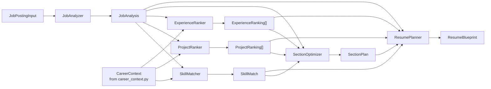

# Resume Intelligence Engine

Sprint 3's deliverable: a deterministic reasoning layer that turns a job
posting plus a user's career context into a **Resume Blueprint** — which
skills to feature, which projects and experience entries to lead with, and
in what section order. It does not generate a PDF, apply to a job, or
scrape a listing; it decides the *shape* a resume should take. Nothing in
this package calls an LLM — every score is computed from curated
vocabularies, regex heuristics, and simple weighted formulas, all
documented below so they're easy to reason about and to eventually replace
piece by piece with model-backed implementations.

## Architecture

```
app/intelligence/
├── models.py            # Pydantic value objects (input, output, and career context)
├── interfaces.py         # Protocols every component satisfies
├── keyword_extractor.py  # Curated-vocabulary keyword extraction
├── job_analyzer.py       # JobPostingInput -> JobAnalysis
├── skill_matcher.py      # user skills vs. job skills -> SkillMatch
├── project_ranker.py     # user projects vs. job keywords -> ranked ProjectRanking[]
├── experience_ranker.py  # user experience vs. job -> ranked ExperienceRanking[]
├── section_optimizer.py  # -> SectionPlan (resume section order)
├── resume_planner.py     # orchestrates everything -> ResumeBlueprint
└── career_context.py     # the only module touching the database
```

Every component but `career_context.py` operates on plain Pydantic value
objects (`JobPostingInput`, `SkillInput`, `ProjectInput`, `ExperienceInput`,
...), not SQLAlchemy models — that's what makes each one independently
testable with in-memory data and no database. `career_context.py` is the
single bridge from the Sprint 2 ORM models to this package, using the
existing repositories (`UserRepository`, `SkillRepository`,
`ProjectRepository`, `ExperienceRepository`, `CertificateRepository`) to
build a `CareerContext` — nothing here is hardcoded; every field comes from
the user's actual profile rows.

`interfaces.py` defines a `Protocol` per component (`JobAnalyzerProtocol`,
`SkillMatcherProtocol`, ...). The concrete classes in this sprint satisfy
them with deterministic logic; a future `LLMJobAnalyzer` or embedding-based
`SkillMatcher` only needs to satisfy the same Protocol; `ResumePlanner` and
every test written against the interface won't need to change.

`ExperienceLevel` and `EmploymentType` are imported directly from
`app.models.enums` (Sprint 2) rather than redefined — a `JobAnalysis`'s
seniority/employment type is meant to line up with the same vocabulary a
`Job` row would eventually use. This is a read-only import; Sprint 2 code
is untouched.

## Pipeline



`ResumePlanner` is the only component that calls the other five — it never
duplicates their logic, only combines their outputs.

## Data flow

1. **Input**: a `JobPostingInput` (title, description, requirements,
   responsibilities, preferred_skills — each of the latter three a list of
   bullet strings, not one free-text blob, so the analyzer's logic stays
   simple and deterministic instead of needing sentence-boundary NLP) and a
   `CareerContext` (built by `CareerContextBuilder.build(user_id)` from the
   Sprint 2 database).
2. **`JobAnalyzer.analyze`** extracts a `JobAnalysis`: required vs.
   preferred skills, seniority (`ExperienceLevel`), employment type,
   categorized `KeywordSet`, education requirements, and certificates —
   all via regex and the shared keyword vocabulary.
3. **`SkillMatcher.match`** compares `context.skills` against
   `job_analysis.required_skills` / `preferred_skills`, producing exact
   matches, related matches, missing skills (tagged `required` or
   `preferred`), a coverage percentage, and a weighted score.
4. **`ProjectRanker.rank`** and **`ExperienceRanker.rank`** each score
   every project/experience entry against the job's keyword profile,
   returning them sorted best-first with a confidence/score and
   human-readable reasons.
5. **`SectionOptimizer.optimize`** classifies the job's role type from its
   keyword profile and picks a fixed section order.
6. **`ResumePlanner.plan`** runs steps 2–5, takes the top 5 projects with
   non-zero confidence, unions exact + related skill matches into
   `recommended_skills`, computes an overall `match_score`, and assembles
   the final `ResumeBlueprint`.

## Scoring formulas

All scores are 0–100 floats, rounded to one decimal place.

### Skill match (`skill_matcher.py`)

For a job skill and the user's skill set:

- **Exact**: normalized strings are equal (case/whitespace-insensitive).
- **Related**: either skill appears in the other's curated
  `_RELATED_SKILLS` alias set (e.g. `"python"` → `{"django", "flask",
  "fastapi", ...}`), **or** `difflib.SequenceMatcher(...).ratio() >= 0.85`
  (catches near-spellings like "Postgres" vs. "PostgreSQL").
- **Missing**: neither of the above.

For a group of skills (required, or preferred):

```
group_score = (exact_count + 0.5 * related_count) / len(group) * 100
```

```
coverage_percentage = (total_exact + 0.5 * total_related) / |required ∪ preferred| * 100
weighted_score       = required_score * 0.7 + preferred_score * 0.3
                        (= required_score alone if there are no preferred skills)
```

Required skills are weighted more heavily (0.7) than preferred (0.3)
because failing to cover a *required* skill is a materially bigger gap
than missing a *preferred* one.

### Project ranking (`project_ranker.py`)

```
job_keywords     = normalize(job.technologies ∪ job.required_skills ∪ job.preferred_skills)
project_keywords = normalize(project.technologies ∪ extract(project.description).all_technical())
matched          = project_keywords ∩ job_keywords

ratio            = len(matched) / max(1, len(job_keywords))
confidence       = min(100, ratio * 100 * priority_multiplier + ongoing_bonus)
```

| Factor | Value |
|---|---|
| `priority_multiplier` | featured ×1.15, high ×1.05, medium ×1.0, low ×0.9 |
| `ongoing_bonus` | +5 if the project has no end date (still active) |

If the job has no extractable keywords at all, every project scores 0
rather than dividing by zero or returning a misleadingly high score.

### Experience ranking (`experience_ranker.py`)

```
score = keyword_score + title_score + recency_score   (capped at 100)

keyword_score  = (matched_keywords / max(1, |job_keywords|)) * 70
title_score    = SequenceMatcher(experience.title, job.title).ratio() * 20
recency_score  = 10                              if is_current
               = max(0, 10 - years_ago_ended)     otherwise
```

Keyword overlap dominates (70 of 100 points) because it's the strongest
signal of actual relevance; title similarity and recency are secondary
signals that break ties between similarly-skilled roles.

### Section order (`section_optimizer.py`)

```
ai_ml_ratio = |job_analysis.keywords.ai_ml| / max(1, |job_analysis.keywords.all_technical()|)
```

| Condition | Order |
|---|---|
| `ai_ml_ratio >= 0.3` | Summary → **Skills** → **Projects** → Experience → Education → Certificates |
| `ai_ml_ratio < 0.3` and no experience scored ≥ 60 | Summary → **Projects** → Skills → Experience → Education → Certificates |
| otherwise | Summary → **Experience** → Projects → Skills → Education → Certificates |

The 30% threshold reflects that an AI/ML-flavored job wants technical
depth demonstrated immediately; a role with no strongly-relevant prior
experience should lead with the strongest evidence actually available
(projects) rather than a weak Experience section.

### Overall match score (`resume_planner.py`)

```
match_score = weighted_score * 0.5
            + avg(top 3 project confidences) * 0.25
            + avg(top 3 experience scores) * 0.25
```

Skill coverage is weighted highest (0.5) since it's the most direct
signal of "can this person do the job"; projects and experience split the
remaining weight evenly (0.25 each) as supporting evidence.

## Example output

Actual output of `ResumePlanner().plan(BACKEND_ENGINEER_JOB, sample_career_context())`
from `tests/intelligence_fixtures.py` (trimmed to the top project for
brevity — the real output includes both projects that matched at all):

```json
{
  "match_score": 54.9,
  "recommended_projects": [
    {
      "name": "Market Data Platform",
      "confidence": 62.5,
      "matched_keywords": ["FastAPI", "PostgreSQL", "Docker", "AWS"],
      "reasons": ["Contains FastAPI", "Contains PostgreSQL", "Contains Docker", "Contains AWS"]
    }
  ],
  "recommended_skills": ["Python", "FastAPI", "AWS", "Docker", "PostgreSQL", "Kubernetes"],
  "missing_skills": [
    {"name": "CI/CD", "importance": "preferred"},
    {"name": "Redis", "importance": "preferred"}
  ],
  "resume_sections": ["Summary", "Experience", "Projects", "Skills", "Education", "Certificates"],
  "reasoning": [
    "Matched 5 skill(s) exactly and 1 via related skills (68.8% coverage).",
    "Missing skill(s): CI/CD, Redis.",
    "Top project 'Market Data Platform' scored 62.5% relevance: Contains FastAPI; Contains PostgreSQL; Contains Docker; Contains AWS.",
    "Most relevant experience: 'Backend Engineer' at Acme Corp (65.0%).",
    "This reads as a standard engineering role with relevant prior experience, so Experience leads immediately after the Summary — the conventional order for this role type."
  ]
}
```

Note `recommended_skills` includes `"Kubernetes"` even though it's a
*preferred* skill the user doesn't have exactly — it matched via the
related-skills table (the user has Docker, which is related to
Kubernetes) and related matches are unioned into `recommended_skills`
alongside exact matches.

## Testing

Every component except `career_context.py` is tested with plain
Pydantic value objects — no database required. `tests/intelligence_fixtures.py`
defines five sample jobs (Backend Engineer, AI Engineer, Research
Engineer, ML Engineer, Python Developer) and one sample `CareerContext`,
reused across:

- `test_intelligence_keyword_extractor.py` — categorization, alias
  resolution, substring false-positive avoidance
- `test_intelligence_job_analyzer.py` — required/preferred skill
  extraction, seniority/employment-type/education detection, per sample job
- `test_intelligence_skill_matcher.py` — exact/related/missing
  classification, coverage and weighted score formulas
- `test_intelligence_project_ranker.py` — correct top-ranked project per
  job, descending sort order, zero-keyword edge case
- `test_intelligence_experience_ranker.py` — correct top-ranked
  experience, recency bonus, descending sort order
- `test_intelligence_section_optimizer.py` — correct section order per
  role category, for all five sample jobs
- `test_intelligence_resume_planner.py` — full blueprint shape and
  content, for all five sample jobs
- `test_intelligence_career_context.py` — the one DB-backed test,
  building a `CareerContext` from real `User`/`Skill`/`Project`/`Experience`
  rows (uses the `db_session` fixture from Sprint 2's `tests/conftest.py`)

## Future AI integration

Nothing in this sprint calls an LLM, but the seams are already in place:

- **`KeywordExtractorProtocol`** — an embedding/LLM-based extractor could
  replace the curated vocabulary with open-vocabulary extraction, without
  `JobAnalyzer`, `ProjectRanker`, or `ExperienceRanker` changing (they only
  depend on the Protocol, and `KeywordExtractor()` is passed in via
  constructor injection everywhere it's used).
- **`SkillMatcherProtocol`** — the curated `_RELATED_SKILLS` alias table
  and fuzzy-string fallback are an explicit, inspectable stand-in for
  embedding-based semantic similarity (e.g. cosine similarity over skill
  embeddings) — swapping the "related" decision for a real similarity
  model requires no change to `ResumePlanner`.
- **`JobAnalyzerProtocol`** — regex-based seniority/employment-type/
  education detection could become an LLM extraction call returning the
  same `JobAnalysis` shape.
- **`ResumePlannerProtocol`** — the deterministic scoring formulas above
  are designed to be replaceable wholesale by an LLM-driven planner that
  reasons over the same `CareerContext` + `JobAnalysis` inputs and returns
  the same `ResumeBlueprint` shape, so nothing downstream (resume
  generation, in a later sprint) needs to know which one produced it.

Every constructor in this package accepts its dependencies as optional
constructor arguments (defaulting to the deterministic implementation) —
`ResumePlanner(job_analyzer=SomeLLMJobAnalyzer())` is how that swap will
look when it happens.
