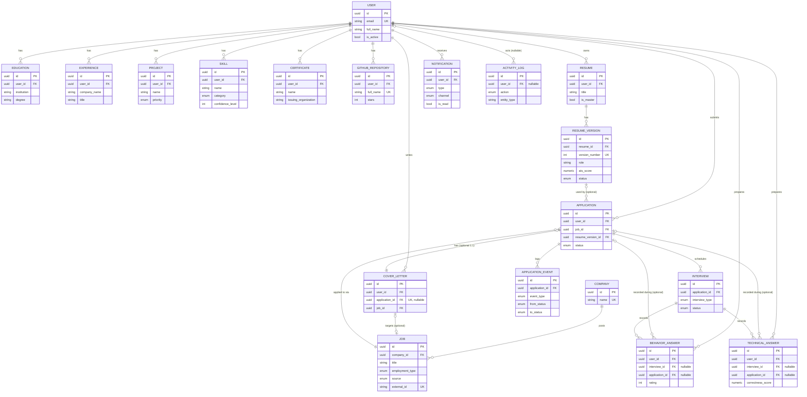

# Career Intelligence Data Layer — Schema Documentation

This is the relational schema that will become the single source of truth
for the AI layers built in later sprints (resume intelligence, job
matching, cover-letter generation, interview prep). This sprint builds
**only** the data layer: SQLAlchemy models, Alembic migrations,
repositories, and Pydantic schemas. No scraping, no browser automation, no
AI agents.

## ER Diagram



## Conventions applied to every table

- **UUID primary keys** (`UUIDPKMixin`, `app/database/base.py`) — generated
  client-side in Python at construction time, not by the database. This
  means a new row's ID is usable immediately (e.g. to wire up a related
  object in the same transaction) without a round-trip, and IDs never leak
  sequential-integer information about row counts.
- **`created_at` / `updated_at`** (`TimestampMixin`) on every table, set by
  the database (`server_default=now()` / `onupdate=now()`), not the
  application — so they're trustworthy even if a bug in application code
  forgets to set them.
- **Soft delete** (`SoftDeleteMixin`, adds `deleted_at`) on every table
  *except* `ApplicationEvent` and `ActivityLog`. Those two are append-only
  audit trails — a "deletable" audit trail defeats its own purpose, so they
  support only a real `DELETE` (see `BaseRepository.delete`, which detects
  the presence of `deleted_at` at runtime and picks soft vs. hard delete
  automatically).
- **Enums as native Postgres `ENUM` types**, not free-text columns or a
  separate lookup table — invalid values are rejected at the database
  level, and application code gets a proper Python `StrEnum`
  (`app/models/enums.py`) instead of magic strings.

## Why each table exists

| Table | Purpose |
|---|---|
| `users` | Root entity. Every other table is scoped to a user, directly or transitively — the single identity the AI layers build a profile around. |
| `educations` | Degrees/institutions, one row per entry, so a resume can be assembled from structured data instead of parsed free text. |
| `experiences` | Work history entries, including `achievements`/`technologies` as arrays — resume/cover-letter generation reads these to tailor language per job. |
| `projects` | Portfolio projects (personal, open-source, freelance), separate from `experiences` because they don't imply employment and carry their own `priority` for which ones to feature. |
| `skills` | Individual skills with `category`, `years_experience`, and self-rated `confidence_level` — the matching engine (future sprint) will score jobs against this. |
| `certificates` | Professional certifications, kept distinct from `educations` since they have their own lifecycle (issue/expiration dates, credential IDs). |
| `github_repositories` | A synced snapshot of a user's GitHub activity (stars, forks, topics) — evidence for technical claims made elsewhere in the profile. `(user_id, full_name)` is unique so a future sync job can upsert idempotently. |
| `resumes` | A logical resume *track* (e.g. "Backend Engineer"). Never edited in place — see `resume_versions`. |
| `resume_versions` | Every generated resume, ever — unlimited versions per the requirement. Each version pins its `role`, target `company`, `generated_at` timestamp, ATS score, and both PDF/DOCX output paths. `(resume_id, version_number)` is unique and monotonically increasing (see `ResumeVersionRepository.next_version_number`). Nothing is ever mutated; a new version is always a new row. |
| `companies` | Normalized employer records so multiple job postings from the same company share one row instead of duplicating company data per posting. |
| `jobs` | Job postings. `(source, external_id)` is unique — not used by any scraper yet, but it's the natural key a future ingestion pipeline needs to upsert postings without duplicating them on re-fetch. |
| `applications` | The join between a user and a job, holding the *current* status. `(user_id, job_id)` is unique — you can't apply to the same job twice. |
| `application_events` | Append-only audit trail of everything that happens to an application (status changes, notes, emails). `applications.status` is the current state for fast filtering; this table is the full history of how it got there. |
| `cover_letters` | Cover letters, optionally tied to an application (`application_id` is unique, enforcing one cover letter per application) or just a job (for speculative outreach before an application exists). |
| `interviews` | Scheduled/completed interview rounds for an application, with type (`phone_screen`, `technical`, ...) and outcome notes. |
| `behavior_answers` | Behavioral (STAR-method) question/answer pairs. Doubles as a *prep bank* (`interview_id` null, drafted ahead of time) and *interview-specific record* (`interview_id`/`application_id` set once actually used) — both FKs are nullable for that reason. |
| `technical_answers` | Same dual-purpose pattern as `behavior_answers`, for technical/coding questions, with `language`/`difficulty`/`correctness_score`. |
| `notifications` | In-app/email/SMS notifications, generic across entity types via `related_entity_type`/`related_entity_id` rather than a FK per notification kind. |
| `activity_logs` | System-wide audit trail of user (or system) actions. `user_id` is nullable for system-generated entries with no acting user. Append-only, like `application_events`. |

## Relationship notes

- **`application_status` is a single named enum reused across two
  tables** (`applications.status` and
  `application_events.from_status`/`to_status`) — declared once in
  `app/models/application.py` as `application_status_enum` and passed
  explicitly to every column that uses it, rather than letting SQLAlchemy
  infer a separate `Enum` per column. This matters because Alembic emits
  one `CREATE TYPE application_status` per *distinct* enum object it sees
  during autogenerate; sharing the instance keeps that to a single
  creation instead of a naming collision. The initial migration's
  `downgrade()` also explicitly `DROP TYPE`s every enum after its owning
  tables are dropped — Alembic's autogenerated `op.drop_table()` does not
  do this on its own, so without it a `downgrade` → `upgrade` cycle would
  fail with `type "..." already exists`.
- **`Application` ↔ `CoverLetter` is one-to-one**, enforced by a
  `UniqueConstraint` on `cover_letters.application_id` (not just an ORM
  convention) — the database itself rejects a second cover letter for the
  same application.
- **Cascade deletes are declared at both layers on purpose.** The FK
  `ondelete="CASCADE"` (e.g. `educations.user_id` → `users.id`) protects
  data integrity even for changes made outside the ORM (raw SQL, another
  service). The ORM-level `cascade="all, delete-orphan"` on the
  relationship additionally lets Python code delete a `User` and have
  SQLAlchemy manage the children's lifecycle in the same unit of work.
  Cross-entity references that shouldn't cascade the whole record use
  `ondelete="SET NULL"` instead (e.g. `applications.resume_version_id` — if
  a resume version is deleted, the application survives, just without a
  linked version).
- **Every FK is indexed.** Postgres does not automatically index foreign
  keys (unlike primary keys); every `*_id` column here has an explicit
  `index=True` so joins and cascade lookups don't degrade to sequential
  scans as tables grow.

## Repository layer

`app/repositories/base.py` defines one generic `BaseRepository[Model]`
with `get`/`list`/`create`/`update`/`delete`, shared by all 19 concrete
repositories in `app/repositories/`. `delete()` checks for a `deleted_at`
column at runtime (`hasattr(self.model, "deleted_at")`) and soft-deletes if
present, otherwise issues a real `DELETE` — this is why `ApplicationEvent`
and `ActivityLog` don't need a separate repository base class despite not
supporting soft delete.

## Pydantic schemas

Every entity has `*Create` / `*Update` / `*Response` schemas in
`app/schemas/`, decoupled from the ORM models so the API contract can
evolve independently of the database shape. `ApplicationEvent` and
`ActivityLog` have no `*Update` schema — consistent with them being
append-only, there is nothing to PATCH.

## Verifying the schema yourself

```bash
docker compose up -d postgres
poetry run alembic upgrade head    # apply
poetry run alembic downgrade base  # roll back cleanly (verifies enum cleanup)
poetry run alembic upgrade head    # re-apply
poetry run alembic check           # confirms models == migrations, no drift
poetry run pytest                  # relationship + CRUD tests
```
